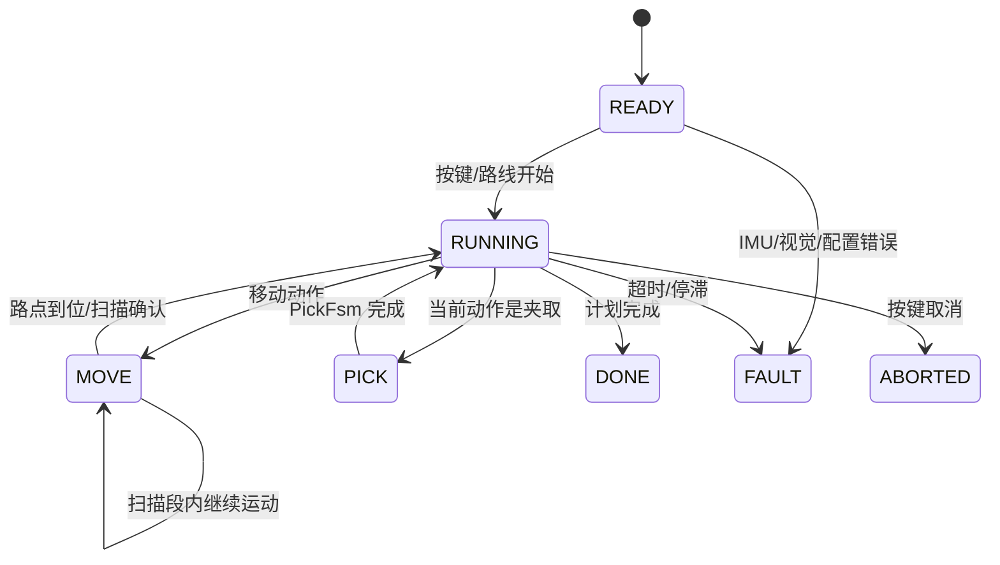

# GongChuangSai 软件架构

## 1. 目录与职责

| 目录或模块 | 职责 | 不应承担的职责 |
| --- | --- | --- |
| `Config/` | 运行模式和比赛参数配置头文件 | 控制算法、硬件驱动和运行时状态 |
| `Core/Src/main.c` | HAL、外设初始化、TIM6 启动、主循环和唯一 TIM6 周期回调 | 比赛业务、视觉解析、机械动作 |
| `App/app_runtime.c` | 运行模式初始化、主循环调度、TIM6 到电机/底盘的桥接 | 新增第二套控制器 |
| `Control/Motor.c` | 单轮 PWM、编码器采样和速度闭环 | 四轮运动学和比赛流程 |
| `Control/mecanum_chassis.c` | 麦轮运动学、里程计、位置 PID、速度/位置目标执行 | UART 协议和机械夹取 |
| `Control/nav.c` | 航向融合、零速修正、打滑检测和位姿辅助 | 直接写底盘目标或处理 UART |
| `App/app_race.c` | 比赛协调、按键、路线、视觉、圆环、夹取互斥 | 直接解析 UART 字节、实现第二套底盘 PID |
| `App/race_fsm.c` | 启停区、路线动作、扫描、到位、取消、超时和故障状态 | 直接操作硬件 UART 或舵机 |
| `App/race_task_plan.c` | 根据二维码颜色/位置生成和推进任务计划 | 直接写底盘目标 |
| `Hardware/vision.c` | USART3 字节流、V4/旧协议、二维码和圆环握手数据 | 直接调用 `Mecanum_SetPositionMode` |
| `App/app_ring_align.c` | 圆环标定换算、限幅、停稳判定、底盘目标和完成握手 | 解析原始 UART 帧 |
| `App/app_pick_fsm.c` | 夹爪 PB14、机构旋转 PB15、升降步进和 PC7 转盘的非阻塞流程 | 控制底盘 |
| `Hardware/bsp_uart_router.c` | 唯一 HAL UART 回调入口，按编译模式路由 | 阻塞发送或执行业务动作 |
| `Hardware/bsp_stepper_openloop.c` 等 | D36/步进脉冲、方向、使能和运动曲线 | 解释比赛任务 |
| `IMU20948/`、`Hardware/app_imu.c` | ICM20948 驱动、姿态解算、偏置和有效性 | 改写底盘目标 |
| `MDK-ARM/`、`GongChuangSai.ioc` | 正式工程和 CubeMX 资源描述 | 作为运行时业务代码 |

## 2. 初始化顺序

```text
HAL_Init
  -> SystemClock_Config
  -> MX_GPIO_Init
  -> MX_TIM1/2/3/4/5/6/9/10/11/12/8_Init
  -> MX_USART3_UART_Init
  -> AppRuntime_Init
       -> 运行模式设备初始化
       -> 四轮 Motor_Init
       -> MecanumChassis_Init
       -> IMU、视觉、夹取和日志初始化
  -> HAL_TIM_Base_Start_IT(TIM6)
  -> while(1): AppRuntime_Poll
```

比赛模式中，`AppRace_Init` 初始化比赛 FSM、输入、UI、夹取 FSM、视觉上下文和圆环控制；圆环标定矩阵无效时，圆环移动由安全门拒绝。

## 3. 实时调度

TIM6 的计数周期是 1 ms。`Core/Src/main.c` 的唯一周期回调先执行四路 `Motor_Update(..., 0.001f)`，每累计 10 次调用一次 `AppRuntime_ChassisTick()`，从而保持 10 ms 麦轮位置环。`AppRuntime_ControlTick()` 在比赛模式下检查 IMU/主循环停滞状态，异常时阻止继续输出并触发故障处理。

主循环中的 `AppRuntime_Poll()` 运行非中断任务：IMU 轮询、视觉协议轮询、比赛 FSM、夹取 FSM、舵机/步进轮询、日志和显示。所有任务必须保持非阻塞；任何串口长报文都应排队发送。

## 4. 比赛状态机

`app_race.c` 是协调层，主要顺序为：

1. 更新 IMU 帧时间和当前底盘反馈。
2. 处理视觉帧并提交二维码任务计划。
3. 若圆环闭环正在运行，则把底盘控制权交给 `app_ring_align.c`，其他动作暂停。
4. 处理按键启动、长按选区、短按开始和运行中取消。
5. 调用 `Race_Tick` 推进固定路点 MOVE、扫描段、等待和故障状态；扫描段通过动作标志与底盘运动并行。
6. 进入夹取任务时只启动 `PickFsm`，夹取完成后推进任务计划。
7. 在状态切换时由比赛协调层设置一次位置目标，底盘位置环在 TIM6 的 10 ms 链路中执行。



`RACE_PICK_DIRECT_KEY_TEST` 当前默认关闭，正式比赛短按进入二维码路线；机械夹取测试仍可通过测试构建配置显式开启。二维码阶段只负责读取并确认任务码，不能描述为完整比赛任务链已完成。

## 5.1 智能搬运规则约束

智能搬运比赛的任务规则是后续比赛状态机、接口设计和验收用例的业务边界。正式规则来源为 `C:\Users\26594\Desktop\比赛相关和项目\GongXun2025-main\工创赛规则.pdf`；以下约束依据用户整理结果并与该文件第 15、19、22、23、25 页交叉核对：

1. 比赛开始后必须先读取二维码，并在显示装置上显示完整、可辨认的任务码；无法确认的二维码、颜色或位置不得猜测继续执行。
2. 任务码由四组三位数组成：第一批颜色/顺序、第一批放置位置、第二批颜色/顺序、第二批粗加工区放置位置。解析后必须保存颜色顺序、位置顺序和批次对应关系。
3. 抓取流程一次只允许处理一个物料。物料稳定放到机器人上并确认未掉落、未倾倒、颜色和位置有效后，才能抓取下一个物料。
4. 第一批物料按任务顺序完成原料区抓取、粗加工区放置和暂存区放置；随后返回原料区执行第二批任务。第二批物料须放在第一批对应物料上方，必须确认下层放置正确、颜色匹配且码垛后物料未掉落。
5. 全部流程完成后必须返回启停区，并在完成状态中保留抓取、放置和码垛结果，供显示和验收读取。
6. 比赛开始后禁止人工遥控和人工触碰；机器人必须在规定行车区域内运行。检测到物料掉落、倾倒、位置错误、危险打滑或其他失效条件时进入安全停止/故障状态。
7. 连续 15 秒没有移动视为本轮结束。运行时间优化必须服从任务正确性、放置等级和失效安全，不能通过跳过确认或缩短稳定等待实现。

状态机实现应将二维码确认、第一批、第二批、码垛确认、返回启停区和安全终止作为可观测状态或事件；测试必须覆盖顺序错误、颜色/位置不一致、未稳定就请求下一件、掉落/倾倒、打滑、15 秒无移动和未回到启停区等拒绝路径。

## 5. 夹取状态机

`app_pick_fsm.c` 通过 `app_pick_motion.c` 发出设备目标，使用忙状态和超时推进，不用 `HAL_Delay`。正向流程覆盖归位、升降接近、抓取、夹紧、上升、放置、夹爪打开、旋转归位和转盘多次动作；反向流程覆盖从车上取料到地面、预夹紧、旋转、放下和升降归位。具体步数、角度、速度和触发剩余步数集中在 `Config/race_config.h` 并由 `PickConfig` 注入。

升降零位是人工建立的开环软件坐标，当前代码没有声称存在自动限位寻找。PB14/PB15/PC7 的舵机动作由统一舵机驱动器排队，PC6/PC8/PC9 的步进由升降轴驱动器控制；转盘步进电机旧控制路径不应与 PC7 舵机路径同时启用。

## 6. OpenMV 与 USART3

`bsp_uart_router.c` 是唯一 HAL UART 回调入口。比赛模式下：

```text
USART3 RX IRQ
  -> HAL_UART_RxCpltCallback
  -> Vision_RxCpltCallback
  -> Vision_RxByte / 环形接收缓冲
  -> Vision_Poll
  -> RaceVision / AppRingAlign / AppRace
```

视觉 TX 使用非阻塞队列和发送完成回调。V4 报文、旧 `#SEQ` 行、二维码结果和圆环 ACK/位置/`STEP_DONE`/`ARRIVED`/`IDLE` 保持兼容。视觉解析不直接写底盘；圆环控制接收结构化数据后计算位移并调用唯一的底盘位置接口。

非比赛模式可以由同一个路由入口把 USART3 交给 D36 文本命令模块。禁止同时启用两个协议消费者，也禁止增加第二个 `HAL_UART_RxCpltCallback`。

## 7. 底盘控制权

正式底盘执行路径只有 `mecanum_chassis.c`。比赛协调、圆环闭环和历史路线模块都只能在自己的动作边界设置目标，不能并行写入。`AppRace` 在圆环活动时设置互斥标志并暂停普通路线；故障、取消和超时统一调用停止路径。TIM6 只消费当前目标并执行电机/底盘控制，不在中断内决定比赛动作。

历史 `app_square.c`、调试显示和 D36 模式仍可在非比赛模式使用，但不能和比赛模式同时成为有效目标写入者。`main_example.c` 仅是注释示例，已从正式 Keil 源文件列表移除后不再参与构建。

## 8. 验证边界

`tests/race` 和 `tests/ulog` 用主机桩验证协议、状态机、握手、错误和日志；它们不能验证 STM32 中断时序、舵机负载、步进失步、机械惯性、摄像头安装和 SD 卡介质。真实验证结果必须写入 `docs/HARDWARE_VERIFICATION.md`。

## 9. 比赛任务函数式架构

比赛业务未来采用类似 GongXun2025 的任务函数式组织：顶层按“扫码、去原料区、相机准备、视觉对准、取料、加工、暂存/码垛、返回启停区”等有意义阶段排列，中层组合路线和机构动作，底层继续负责各自控制细节。详细规范见 [`RACE_ARCHITECTURE_RULES.md`](RACE_ARCHITECTURE_RULES.md)。

这是未来的组织规则，不代表当前所有源码已经符合目标，也不授权立即进行全工程重构。后续只在实际需求范围内逐步整理，保留现有 `AppRuntime_Poll()` / `AppRace_Poll()` 非阻塞体系和 TIM6 1 ms 电机更新、10 ms 底盘环。

调用方向保持为：`AppRace` 统一协调，`RaceFsm` 执行路线动作，`RaceTaskPlan` 提供任务数据，`PickFsm` 执行机械组合动作，Vision 提供通信和结构化数据，Control 保留唯一底盘位置环。不得把计划中的未来任务描述成当前已实现的扫码、原料区或完整比赛功能，也不得用该规范替代源码和实机证据。
