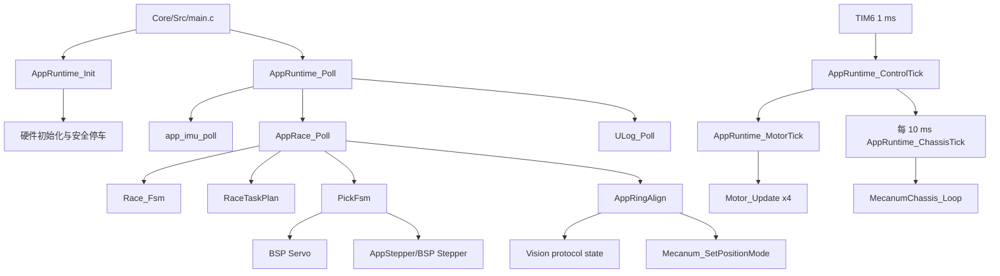
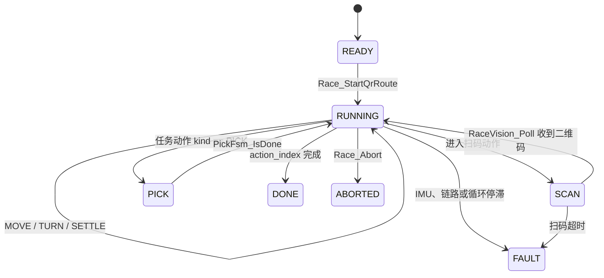
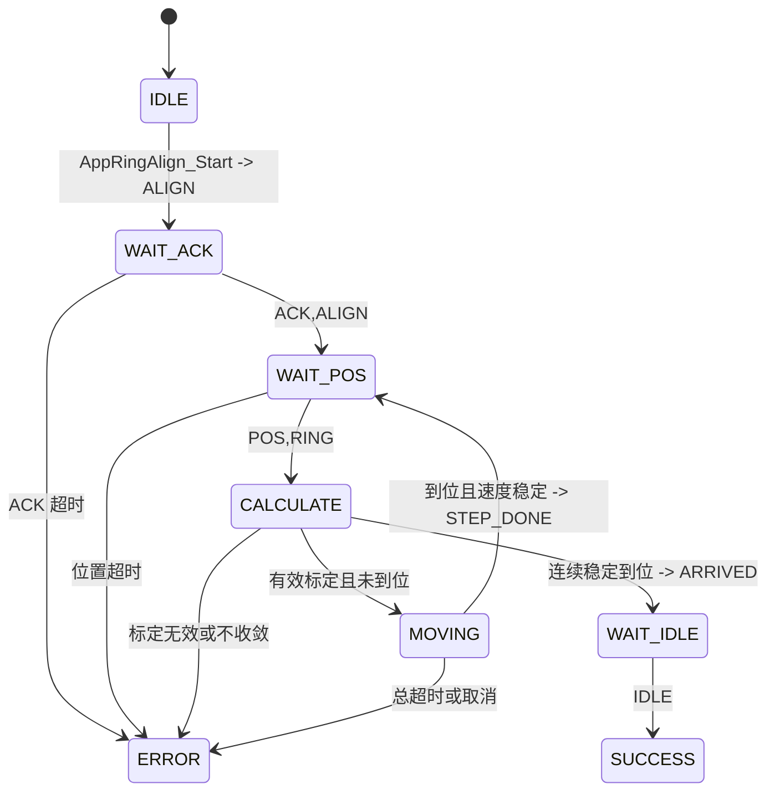
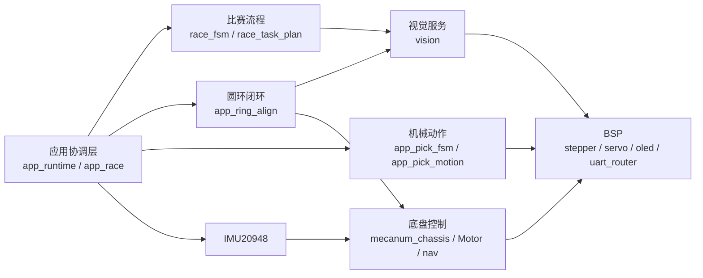

# GongChuangSai 重构后架构

重构分支：`refactor/architecture-v2`

## 目标

正式工程继续使用 STM32 HAL、TIM6 实时调度、四轮编码器速度环、麦克纳姆里程计、
IMU 和位置 PID。整理工作只改变应用层职责和仓库组织，不替换已经验证的电机方向、
轮径、轮距、PID 参数、步进参数或机械动作参数。

## 目录职责

| 层次 | 模块 | 职责 |
| --- | --- | --- |
| 启动与调度 | `Core/Src/main.c` | HAL、时钟、外设初始化；启动 TIM6；调用运行时入口。 |
| 运行时 | `App/app_runtime.c` | 按 `APP_RUN_MODE` 选择应用，初始化硬件，调度主循环和 TIM6 控制周期。 |
| 底盘执行 | `Control/Motor.c` | 单轮编码器速度环、PWM 输出和电机停止。 |
| 底盘执行 | `Control/mecanum_chassis.c` | 里程计、坐标变换、位置 PID、速度限制和四轮运动学。 |
| 底盘执行 | `Control/nav.c` | 航向融合、零速修正、打滑检测和位姿辅助。 |
| 比赛协调 | `App/app_race.c` | 比赛入口、按键、故障门控、动作切换、夹取和圆环应用协调。 |
| 比赛路线 | `App/race_fsm.c` | 启停区、路线动作、二维码扫描、超时和取消。 |
| 任务规划 | `App/race_task_plan.c` | 将二维码颜色和位置转换为物料任务队列。 |
| 夹取执行 | `App/app_pick_fsm.c` | 舵机、升降步进和转盘动作的非阻塞状态机、超时和故障处理。 |
| 夹取参数 | `App/app_pick_motion.c` | 机械姿态、角度、高度、步数和速度参数换算。 |
| 视觉传输 | `Hardware/vision.c` | USART3 收发、V4 帧、旧 `#SEQ`、二维码缓存、圆环协议握手。 |
| 圆环控制 | `App/app_ring_align.c` | 标定矩阵换算、误差限幅、底盘目标提交、限速恢复、停稳判断和握手推进。 |
| UART 路由 | `Hardware/bsp_uart_router.c` | 唯一 HAL UART 回调入口，按应用模式转发到视觉或 D36 命令模块。 |
| 设备驱动 | `Hardware/bsp_servo.c`、`bsp_stepper.c`、`app_stepper_*` | 舵机 PWM、D36 步进脉冲及上层运动接口。 |

## 控制链

```text
main.c
  -> AppRuntime_Init / AppRuntime_Poll
       -> AppRace_Poll
            -> Race_Fsm / RaceTaskPlan
            -> AppRingAlign -> Vision 协议状态 -> Mecanum_SetPositionMode
            -> PickFsm -> Servo / Stepper
       -> app_imu_poll / ULog_Poll

TIM6 1 ms
  -> AppRuntime_MotorTick -> Motor_Update x4
TIM6 10 ms
  -> AppRuntime_ChassisTick -> MecanumChassis_Loop
```

比赛模式下，底盘目标只由 `app_race.c` 的路线动作和 `app_ring_align.c` 的圆环闭环
提交；两者通过比赛协调层互斥。位置 PID 仍只有 `MecanumChassis_Loop()` 一套，
没有新增第二个控制器。`Core/Src/main.c` 保持未修改。

## 视觉协议边界

`vision.c` 接受带校验和的 V4 帧，并保留旧 `#SEQ` 任务报文。普通二维码任务继续
使用 `RaceVision_*` 兼容接口；圆环使用 `ALIGN`、`POS,RING`、`STEP_DONE`、
`ARRIVED` 和 `IDLE` 握手。像素误差到车体位移的换算已移到 `app_ring_align.c`，
所以通信模块不会直接写底盘目标。

圆环自动移动只有在 `race_config.h` 的 2x2 标定矩阵有效时才允许启动。当前矩阵为
全零，固件会安全拒绝自动运动；这是等待实机标定参数的配置状态，不是测试失败。

## 与参考工程的对应关系

参考工程的 `User`、`CarBody`、`Hardware`、`Control` 分层被映射到当前工程的 HAL
启动层、底盘执行层、设备驱动层和应用协调层。没有把参考工程的旧驱动直接覆盖到
当前工程，避免改变当前 HAL、编码器和 PID 行为。

## 重构前后职责映射

| 重构前 | 重构后 | 变化 |
| --- | --- | --- |
| `vision.c` 同时处理通信和圆环位移控制 | `vision.c` + `app_ring_align.c` | 传输与运动控制分离，公开协议接口保持兼容。 |
| `app_race.c` 直接承担所有业务推进 | `app_race.c` 协调，`race_fsm`、`race_task_plan`、`app_pick_fsm` 分工 | 比赛流程、任务规划、夹取执行独立。 |
| 多个模式各自处理 UART 回调 | `bsp_uart_router.c` 统一入口 | 消除重复 HAL 回调定义。 |
| 根目录混放历史工程、日志和工具 | `archive/`、`docs/`、`tools/`、`field_assets/` | 正式工程与历史资产分开，归档内容可回溯。 |

## 当前真实目录

```text
GongChuangSai/
├── Core/                 STM32 HAL 启动、外设和中断桥接
├── Drivers/              STM32 HAL 与 CMSIS
├── IMU20948/             ICM20948 驱动和姿态解算
├── Hardware/             应用、控制、BSP、视觉和日志模块
├── MDK-ARM/              GongChuangSai.uvprojx
├── vision_openmv_stm32_v4_redownload/OpenMV/
├── tests/                race 与 ulog 主机测试
├── tools/                日志分析和查看器工具
├── docs/                 架构、协议和验收文档
└── archive/              可恢复的历史工程与压缩包
```

## 系统调用关系图



## 竞赛动作状态机



## 视觉闭环状态机



## 机械抓取状态机

```mermaid
stateDiagram-v2
    [*] --> PICK_IDLE
    PICK_IDLE --> PICK_RESETTING: PickFsm_Reset
    PICK_IDLE --> FORWARD_HOME: PickFsm_Start
    PICK_IDLE --> REVERSE_HOME: PickFsm_StartReverse
    FORWARD_HOME --> FORWARD_TO_APPROACH --> FORWARD_TO_GRAB
    FORWARD_TO_GRAB --> FORWARD_CLOSE --> FORWARD_RAISE
    FORWARD_RAISE --> FORWARD_OPEN --> FORWARD_RESET_ROTATE
    FORWARD_RESET_ROTATE --> DONE
    REVERSE_HOME --> REVERSE_RAISE --> REVERSE_TURN
    REVERSE_TURN --> REVERSE_CLOSE --> REVERSE_RAISE_AFTER_CLOSE
    REVERSE_RAISE_AFTER_CLOSE --> REVERSE_HOME_ROTATE
    REVERSE_HOME_ROTATE --> REVERSE_RELEASE --> REVERSE_RESET_ZERO
    REVERSE_RESET_ZERO --> DONE
    FORWARD_HOME --> FAULT: 超时或命令错误
    REVERSE_HOME --> FAULT: 超时或命令错误
    FORWARD_TO_GRAB --> ABORTED: PickFsm_Abort
    REVERSE_TURN --> ABORTED: PickFsm_Abort
```

## 模块依赖图



