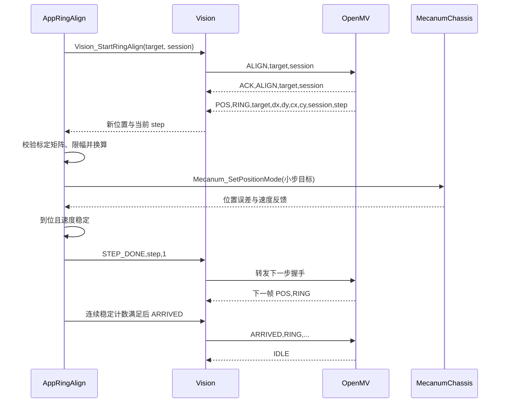

# 数字圆环视觉闭环流程

## 参与模块

- `Hardware/vision.c/.h`：USART3 协议、序号、session、step、位置缓存和握手消息。
- `App/app_ring_align.c/.h`：标定矩阵、误差换算、车体到世界坐标转换、限幅、
  速度限制、停稳判断和底盘目标提交。
- `App/app_race.c`：在主循环中调度闭环，并与路线/夹取状态互斥。
- `Control/mecanum_chassis.c`：唯一位置 PID 和底盘运动学执行。

## 状态流程

## 关键保护

1. 标定矩阵行列式无效时，`AppRingAlign_Start` 仍可建立协议会话，但计算阶段立即
   报错，绝不写底盘目标；当前 `Config/race_config.h` 矩阵全零，因此实机标定前不会自动动。
2. 每一个 `POS,RING` 必须匹配 target、session 和 step；旧坐标会被丢弃。
3. 移动阶段不接受到位判定。只有 `Mecanum_IsTargetReached()` 成立、线速度和角速度
   低于稳定阈值并持续 `VISION_RING_STABLE_MS` 后，才发送 `STEP_DONE`。
4. 到位需要 `VISION_RING_STABLE_COUNT` 次稳定观测，之后发送一次 `ARRIVED`，进入
   `WAIT_IDLE`，不会重复发送运动目标。
5. ACK、位置、总时限、取消和通信错误均会退出闭环；应用协调层负责调用停车路径。

## 不能自动证明的部分

主机测试覆盖 session、重复 step、标定移动、停稳和握手顺序，但无法替代真实摄像头
噪声、串口电平、底盘惯性和标定精度测试。
